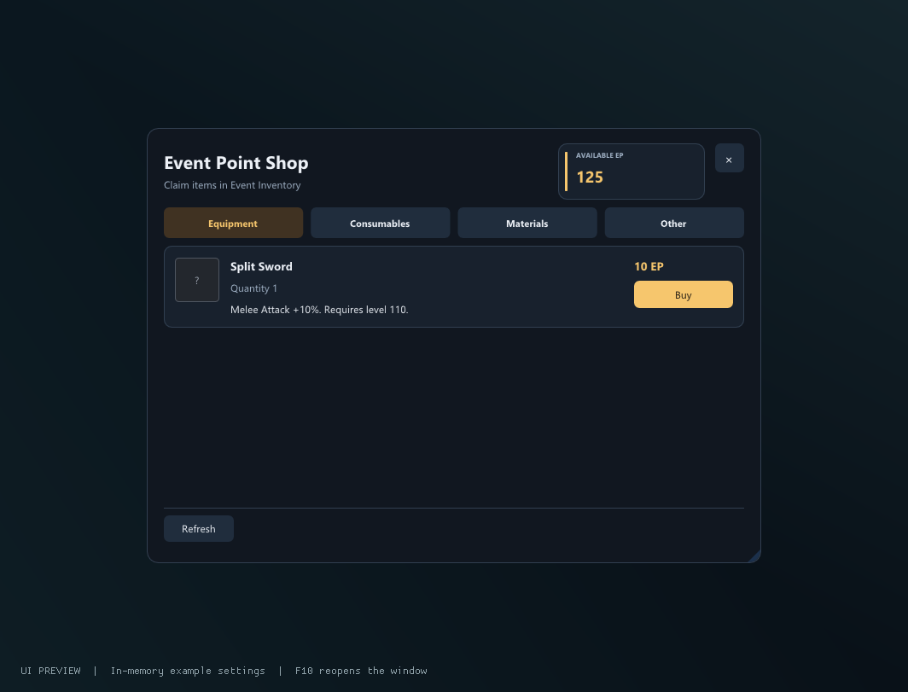

# Event Point Shop

Type `.epshop` in normal Say chat while in a safe zone. Choose Equipment, Consumables, Materials, or
Other. **Equipment** lists **Split Sword** (2621591), one weapon with **Melee
Attack +10%** for **10 EP**. **Materials** lists **Guild Stone** (2884093),
**250 for 10 EP**. Buy opens a confirmation showing the quantity and cost.
The server delivers the item to the buying character's **Event Inventory**;
open/reopen that native inventory and claim it there.
Outside a safe zone, `.epshop` shows a chat notice and keeps the window closed.

The server controls the catalog in `RohanGame.dbo.EventPointShopCatalog`, including
categories, names, item types, quantities, prices, descriptions, enabled state
and display order.
Adding/editing an item requires no DLL rebuild. Refresh fetches current offers and
balance. No item IDs or prices are hardcoded in the production client.

Use the paired rebuilt `bin/Release/novaclient.dll` (also copied to the generated
`bin/Autoload` folder by the build), the server's
`bin/EventPointShop/Hero4Hook.dll`, and its SQL/configuration installation. See
the sibling server workspace's `docs/EVENT_POINT_SHOP.md` and
`docs/EVENT_POINT_SHOP_SQL.md` for deployment and catalog administration.

The UI uses the game's native item icon resources. Static evidence and guards
are documented in [icon evidence](evidence/event-shop-icons/REVIEW.md). Missing
resources show `?`. Hover the icon for the name, item ID, quantity, catalog
description and delivery destination.

After a timeout, **Check purchase** retries the same purchase identity. Further
purchases remain blocked until a definitive result arrives. Switching accounts
clears the client state; committed purchases remain in Event Inventory. Check
that inventory before intentionally repeating a purchase after reconnecting.

Build with `tools/build.cmd`. Relevant tests are `tests/test-event-shop.cmd`,
`tests/test-bridge.cmd`, `tests/test-input.cmd`, and `tests/test-render.cmd`.
The independent mock preview is `bin/Release/AhkPreview.exe --event-shop`.
From the project directory, add `--snapshot` to render
`docs/event-shop-preview.png` in a hidden window and exit. The preview uses
example points and a placeholder icon; it does not load the game or access SQL.

Live game icon rendering, Event Inventory claiming, and relog/device-reset
behavior remain to be verified on the paired game installation.
